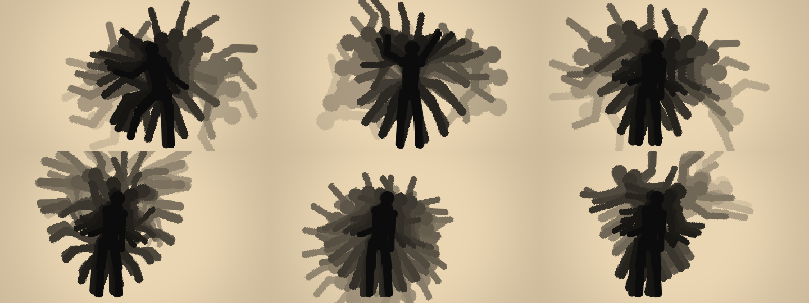

# TEMPORAL BODY BLOOM — Live 4D Dance Shadow Sculpture

A real-time TouchDesigner artwork. A dancer stands in front of a camera, and their
earlier **key poses** stay behind them as distinct black silhouettes. Each silhouette
is a different past moment. They rotate, scale and spread around the dancer's
**tracked body pivot**, building a tree or flower of bodies on a warm ivory field.

> "I move through time, and every important movement becomes another branch of my body."



*These are offline CPU reference renders of the exact engine plus a numpy port of the
compositing shader, driven by the built-in procedural Test Dancer.
Top row: REFERENCE at 4 s, 8 s and 12 s. Bottom row: TREE, MANDALA and 4D ECHO at 12 s.*

---

## Status — read this first

**This network was not built or run inside TouchDesigner.** It was authored in a Linux cloud
session that had no TouchDesigner MCP connection. TouchDesigner doesn't run on Linux. What
*was* verified:

| Check | How |
|---|---|
| All 10 GLSL shaders compile | `glslangValidator`, with a TD-style prelude (`sTD2DInputs`, `uTD2DInfos`, `vUV`) |
| Engine logic: key-pose gate, TIMED/KEYPOSE/HYBRID, freeze, reset, slot spacing, pivot maths, MediaPipe channel matching, mask-fallback pose | 19 unit tests (`tests/test_engine.py`) |
| History rotates around the **body pivot**, not the screen centre | Unit test: the current pivot maps exactly onto each historical pivot, and the screen centre does not |
| Silhouettes are **distinct past poses** (not the current frame copied, not feedback) | End-to-end CPU simulation and the preview renders above |
| Builder script and per-frame callbacks run without Python errors | Dry run against a mock TD API (`tools/mock_td.py`): builds all 12 sub-networks, wires 27-input GLSL TOPs, runs 300 frames, presets and reset |

What still has to be confirmed **in TouchDesigner**: parameter names that differ between
TD builds (see *Troubleshooting*), GPU cooking, and the live camera. The builder sets every
version-sensitive parameter through a fallback list and prints anything it could not set.
About 3 seconds after building, it also prints a **self-check** to the Textport.

---

## Install & run (≈1 minute)

1. Copy the folder `touchdesigner/temporal_body_bloom/` next to your `.toe`, or anywhere else.
2. Open TouchDesigner (2022.x or newer) and open the Textport (**Alt+T**).
3. Run:
   ```python
   SRC = r'C:/path/to/temporal_body_bloom'
   exec(open(SRC + '/build_temporal_body_bloom.py').read())
   ```
4. Select `/project1/TEMPORAL_BODY_BLOOM` and open its parameters (**P**).
   * To check the pipeline first, set **Input Source = Test Dancer**. A procedural
     dancer drives the whole network: segmentation, pose, memory, bloom and output.
   * For a live performance, set **Input Source = Camera** and pick the **Camera Device**.
     **Step out of frame** and pulse **Capture Background** (it is also captured
     automatically ~1.5 s after start). Then step in and dance.
5. Turn on **Fullscreen** to send `FINAL_OUT` to the projector. **Output Monitor** selects
   the display, and the TD UI stays on your operator screen.
6. To see the self-check again: `mod('/project1/TEMPORAL_BODY_BLOOM/12_DEBUG/self_check').self_check()`

Re-running the builder destroys and rebuilds the COMP.

---

## Using a real person-segmentation / pose model (recommended)

The built-in fallbacks let the whole network run **without any ML package**:

* **Mask:** background subtraction against a captured empty-stage plate. A luma key
  or the input's alpha channel are alternatives.
* **Pose:** 13 landmarks estimated from the mask's geometry. Head is the top of the
  mask, wrists are the farthest arm points, ankles are the lowest points on each side.
  The pivot is accurate. The limbs are approximate.

For best results, connect MediaPipe. The MediaPipe TouchDesigner plugin
(`torinmb/mediapipe-touchdesigner`) works, as does any NVIDIA / ONNX equivalent:

| Parameter (Segmentation / Pose page) | Point it at |
|---|---|
| **External Mask TOP** | The plugin's *person segmentation* TOP. `Segmentation Source = Auto` switches to it |
| **MediaPipe Pose CHOP** | The plugin's *pose landmarks* CHOP |

Pose channels are matched by name: `left_wrist:x`, `pose:left_wrist:tx`, `p1/left_wrist_x`,
`landmark15_x`, `pose_15_x` and similar. MediaPipe's y-down coordinates are flipped with
**Pose Y Is Down**. Turn on **Mirror Pose X** if the model sees an un-mirrored camera.

---

## Network (`/project1/TEMPORAL_BODY_BLOOM`)

```
01_INPUT            cam_in ─┐
                    test_dancer ─┼─ src_switch → cam_flip (Mirror) → cam_res (1280×720) → CAM_OUT
                    movie_in ─┘
02_SEGMENTATION     CAM_OUT → seg_small (640×360) → seg_mask (GLSL: bg-sub | luma | alpha | ML)
                    → erode → dilate → mask_up (1280×720) → mask_blur → edge_crisp
                    → SEGMENT_MASK → SEGMENT_MASK_OUT          (bg_plate = Cache TOP, size 1)
03_POSE_TRACKING    mask_small (128×72) · ext_pose · pose_out (Script CHOP, EMA) → POSE_DATA_OUT
04_TEMPORAL_MEMORY  hist_res (960×540 mono) → history_cache (Cache TOP ring buffer)
                    → hist_00 … hist_23 (Cache Select, one past pose each)
                    bloom_engine (Text DAT module) · frame_exec (Execute DAT) · history_info
05_KEYPOSE_ANALYSIS keypose_chop (pose_difference, capture) → KEYPOSE_OUT · keypose_trail
06_BODY_TRANSFORMS  params_tex (Script TOP, 32×20 RGBA32F) · instance_table
07_TEMPORAL_BLOOM   bloom_comp (GLSL, 27 inputs, 1920×1080) → BLOOM_OUT
08_PARTICLE_DECAY   dissolve_src (edge emission) → dust_sim ⟲ dust_feedback → DUST_OUT
09_COMPOSITE        final_comp (bloom + dust) → COMP_OUT
10_OUTPUT           FINAL_OUT (1920×1080) · FULLSCREEN_OUT (Window COMP) · recorder (H.264)
                    preview_switch → PREVIEW_OUT (final or debug wall)
11_CONTROLS         par_exec · presets table · control_panel (Parameter COMP) · README
12_DEBUG            debug_grid (3×3 wall) + fps_text → DEBUG_OUT · self_check
```

### How the temporal memory works (why it is *not* a feedback trail)

1. Each frame, `frame_exec` reads the pose, then `bloom_engine` decides whether this
   frame is a **key pose**:
   * **TIMED:** every frame is captured.
   * **KEY POSE:** a frame is captured when `pose_difference > MovementThreshold`.
   * **HYBRID:** the key-pose rule, OR a frame is captured when `MaxInterval` has
     elapsed since the last capture.

   `pose_difference` is the mean displacement of the wrists, elbows, knees and ankles
   compared with the last accepted pose. The poses are aligned on the pelvis and the
   result is divided by torso length, so walking across the stage is not counted as
   a new pose.
2. The Cache TOP's **Active** flag is set only on captured frames. Each stored frame is
   kept as an individual image, never averaged. The engine keeps a parallel ring
   buffer holding each frame's **pivot**, timestamp, landmarks, reach vector and
   motion vector.
3. Instance *i* reads cache entry `-slot[i]` through its own Cache Select TOP:
   * KEY POSE / HYBRID: `slot = 1, 2, 3, …` (one key pose further back each time).
   * TIMED: frames ago, with growing gaps. For 11 slots in 90 frames this gives
     4, 7, 12, 16, 21, 28, 34, 42, 51, 62, 74, within one frame of the brief's spacing.
4. One GLSL pass (`bloom_comp`) inverse-maps every output pixel into each of the up to
   24 historical masks:

   `p' = pivot_now + radialOffset + R(rot)·S(scale)·(p − pivot_then)`

   This is T(pivot)·T(offset)·R·S·T(−pivot). It rotates around the **tracked body
   centre** (`lerp(pelvis, shoulders, 0.35)`), never the screen centre. Shadows are
   combined with a **maximum** blend.

### Sculpture rules

* Instances alternate between **CLOCKWISE_BRANCH** and **COUNTERCLOCKWISE_BRANCH**.
  For 16 poses each family gets 8 rotations: 0, 17.9, 35.7 … 125°.
* `age = i/(n−1)`.
* `scale = 1 + age·ScaleSpread`.
* `radialDistance = famAge^1.3 · RadialDistance`.
* `opacity = mix(MaxOpacity, MinOpacity, age^DecayExponent)`.
* **Vertical Bias** is negative for upward, matching the brief's image-space convention.
* **Branch Noise** is seeded per capture, so a silhouette doesn't jitter once it has
  been placed.
* **Joint Branch:** each capture stores a *reach* vector (where the wrists and ankles
  extend relative to rest) and a *motion* vector (extremity displacement since the
  previous key pose). These push older bodies along the choreography. Raise the right
  arm and the history branches up and to the right. With Symmetry off (4D ECHO), the
  branch side follows the reach.
* **Trunk preservation:** near the pivot the transform is damped by `Trunk Preservation`
  over `Trunk Radius`. Torsos stay overlapped as one trunk while arms, legs and heads
  branch outward.

---

## Parameters

TouchDesigner custom-parameter names must start with one capital letter followed by
lower-case letters, so the brief's names are mapped like this:

| Brief | TD parameter | Default |
|---|---|---|
| Camera / Mirror | `Camera`, `Mirror` | —, On |
| Processing / Final Resolution | `Procw`×`Proch`, `Finalw`×`Finalh` | 1280×720, 1920×1080 |
| HistoryMode | `Historymode` (TIMED / KEY POSE / HYBRID) | HYBRID |
| HistoryLength / PoseCount | `Historylength`, `Posecount` (12–24) | 90, 16 |
| MovementThreshold | `Movementthreshold` (+ `Maxinterval` 0.6 s, `Mininterval` 0.1 s) | 0.08 |
| RotationSpread / ScaleSpread | `Rotationspread`, `Scalespread` | 125°, 0.28 |
| RadialDistance / VerticalBias / BranchNoise | `Radialdistance`, `Verticalbias`, `Branchnoise` | 0.20, −0.10, 0.04 |
| JointBranchStrength / Symmetry | `Jointbranchstrength`, `Symmetry` | 0.25, On |
| PoseSmoothing | `Posesmoothing` (EMA) | 0.18 |
| SilhouetteOpacity / MaximumOpacity / MinimumOpacity / DecayExponent | `Silhouetteopacity`, `Maximumopacity`, `Minimumopacity`, `Decayexponent` | 1.0, 0.92, 0.12, 1.6 |
| SegmentationThreshold / MaskBlur / Erode / Dilate | `Segthreshold`, `Maskblur`, `Erode`, `Dilate` | 0.16, 3, 1, 2 |
| CurrentBodyMode | `Currentbodymode` (BLACK SILHOUETTE / LIVE VIDEO / HIDDEN) | BLACK SILHOUETTE |
| Ink values | `Historyink`, `Currentink` | 0.02, 0.05 |
| BackgroundBrightness / BackgroundWarmth | `Backgroundbrightness`, `Backgroundwarmth` | 0.92, 1.0 → RGB (0.92, 0.84, 0.70) |
| ParticleDissolve / ParticleCount / ParticleLifetime | `Particledissolve`, `Particlecount`, `Particlelifetime` (+ noise, drift, range) | Off, 8000, 2.5 s |
| Trails | `Showwristtrails`, `Showankletrails`, `Traillength`, `Trailwidth`, `Trailopacity` | Off, Off, 24, 0.006, 0.6 |
| Freeze / ResetHistory | `Freeze`, `Resethistory` (pulse) | — |
| Fullscreen / Record / DebugView | `Fullscreen`, `Record`, `Debugview` (+ `Outputmonitor`) | Off |
| Presets | `Preset` menu, plus the `Applypreset` pulse | REFERENCE |

**Presets:**
* **REFERENCE:** wide symmetric fan, black on ivory.
* **TREE:** crown of bodies above a single trunk.
* **MANDALA:** 24 key poses spread over ±172° in a circular many-armed figure.
* **4D ECHO:** asymmetric; follows motion vectors; particle dissolve on.

**Freeze** stops accepting new frames. The sculpture stays, and the live performer
keeps moving in front of it.

**Reset History** clears the engine ring buffer, the Cache TOP, the trails and the dust
feedback. It then restarts capture from the current frame.

**Record** writes `recordings/temporal_body_bloom_<timestamp>.mp4` from `FINAL_OUT`. The
codec is H.264, using NVENC if available.

---

## Particle dissolve & trails

* When **Particle Dissolve** is on, the oldest `Dissolverange` share of silhouettes break
  up in the shader: edges first, then grains, drifting slowly upward, then gone.
  `dissolve_src` emits their edge pixels into a GPU dust field (`dust_sim` plus a
  Feedback TOP: noise flow, low gravity, slight upward drift). `final_comp` lays the
  dust over the bloom.
* **Trails:** the last `Traillength` positions (up to 32) of each wrist and ankle are drawn as anti-aliased
  ribbons in the same pass. They are off by default.

---

## Debug wall (`Debugview` on, or view `12_DEBUG/DEBUG_OUT`)

```
camera + 13 landmarks + pelvis/body centre | segmentation mask + pivot | final output (red = capture)
history slot 0                             | slot 5                     | slot 10
slot 15                                    | dissolve emission          | dust field
```

The top-left text shows the FPS, the pose source, the number of stored history frames
and the live `pose_difference`. `06_BODY_TRANSFORMS/instance_table` lists every
silhouette's family, slot, angle, scale, offset, opacity and historical pivot.

---

## Performance notes

* Segmentation and morphology run at 640×360. The mask is upscaled to 1280×720 for
  the live body.
* History is stored at 960×540 in 8-bit mono: 90 frames is about 47 MB of VRAM.
* The engine downloads only a 128×72 mask each frame, one frame delayed so the GPU
  doesn't stall.
* The bloom uses a single 1920×1080 GLSL pass: 24 instances × 1 texture fetch each.
  No per-pixel Python.
* If the GPU struggles: lower `Posecount`, set `Finalw/Finalh` to 1280×720 (the window
  still scales it up), or turn Particle Dissolve off.

## Troubleshooting

| Symptom | Fix |
|---|---|
| Builder prints `warn: … none of [...] exist` | A parameter name differs in your TD build. Set it by hand on the named operator. Most likely: Cache Select `cacheindex` / `top`, Window COMP `size`, Movie File Out `videocodec`, Resolution TOP `format` |
| `params_tex` looks black or clipped | Its pixel format must be **32-bit float RGBA** (`06_BODY_TRANSFORMS/params_tex` → Common page) |
| Mask is noisy or empty | Step out of frame and pulse **Capture Background**. Tune `Segthreshold` / `Segsoftness`, or connect an ML mask |
| All silhouettes overlap the body | Not enough movement yet. Lower `Movementthreshold`, or use HYBRID/TIMED |
| Sculpture drifts with the camera | Fix the camera in place. Background subtraction needs a static shot |

## Not built (optional advanced modes)

The brief says `TIME_DEPTH_MODE` (age as Z depth, rendered through a Camera COMP) and
`POSE SCULPTURE` (contour → SOP geometry) should only be added once the 2D live effect
is confirmed working. Since this build hasn't been confirmed in TouchDesigner yet, they
were left out on purpose.

## Offline development

```bash
pip install numpy pillow
python -m unittest discover -s touchdesigner/temporal_body_bloom/tests   # 19 tests
python touchdesigner/temporal_body_bloom/tools/cpu_reference.py          # preview PNGs
python touchdesigner/temporal_body_bloom/tools/mock_td.py                # builder dry run
```
